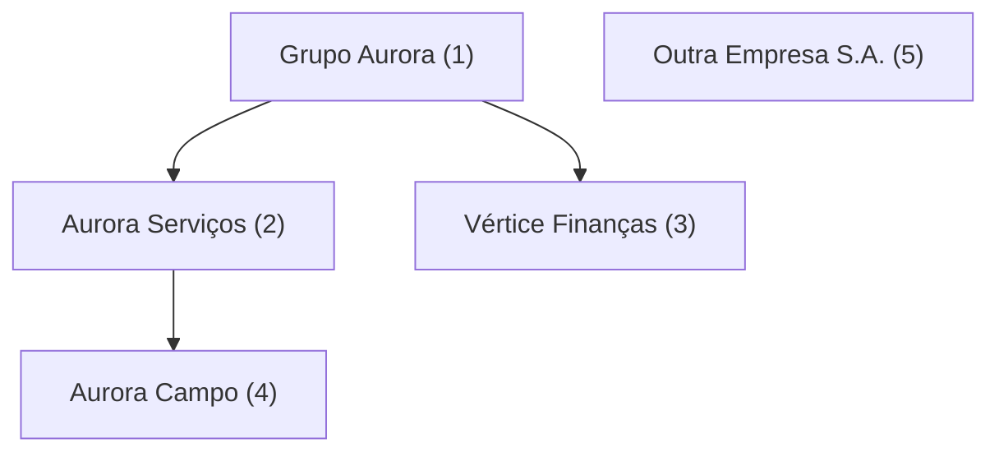

# Arquitetura

O código é separado **por funcionalidade** e, dentro de cada uma, em
**domínio** e **adaptadores**:

```
src/
├── empresas/dominio/arvore.js              descendentes(), montarArvore()
├── acesso/dominio/
│   ├── permissoes.js                       permissoesDe(): quem pode o quê
│   └── erros.js                            AcessoNegado
├── tarefas/
│   ├── dominio/listar.js                   listarTarefas()
│   ├── dominio/prazo.js                    prazoSLA()
│   ├── dominio/validacao.js                validarTarefa()
│   ├── adaptadores/csv-excel.js            gerarCSV(): formato Excel pt-BR
│   └── adaptadores/repositorio-pglite.js   SQL como a pessoa logada
├── vendas/
│   ├── dominio/relatorio.js                totalDoDia(), ticketMedio()
│   └── adaptadores/moeda.js                formatarBRL()
├── feriados/
│   ├── dominio/feriados.js                 quais são feriados nacionais
│   ├── adaptadores/brasilapi.js            busca e traduz a resposta da API
│   └── adaptadores/arquivos.js             lê data/feriados-*.json no servidor
├── banco/adaptadores/pglite.js             Postgres em memória, sessão por requisição
├── api/http.js                             rotas HTTP → domínio e repositório
├── ui/
│   ├── App.jsx, componentes/               a tela
│   ├── fontes.js                           cliente da API (único lugar que sabe de onde vêm os dados)
│   └── adaptadores/download.js             texto → arquivo baixado
└── tarefas.js · prazo.js · exportar.js · relatorio.js · App.jsx · main.jsx
                                            fachadas: o contrato da prova, nos caminhos originais
scripts/                                    comandos (npm run …): montam as peças e fazem I/O
sql/                                        schema, RLS e migrações
```

## Regras

1. **O domínio não depende de nada de fora.** Nada em `dominio/` importa
   adaptador, tela, módulo do Node, arquivo JSON ou biblioteca, nem usa
   `fetch`, `document`, `window` ou `import.meta`. O
   `test/arquitetura.test.js` verifica isso em todo arquivo de `dominio/`.
2. **Adaptador traduz, não decide.** Ele converte o formato de fora (resposta
   de API, CSV do Excel, HTTP, SQL) para o formato do domínio, ou o contrário.
3. **Permissão é do banco.** A API e o repositório não filtram por empresa:
   cada operação roda como a pessoa logada e o RLS decide. Desligando o RLS, os
   testes de escrita proibida da API quebram.
4. **A tela não sabe de onde vêm os dados.** Só `src/ui/fontes.js` conhece a
   API. Quando a fonte passou dos JSON de `data/` para a API, só ele mudou.
5. **Os caminhos originais são fachadas.** Só reexportam, mantendo os nomes e
   parâmetros pedidos pela prova. O `test/contrato.test.js` garante isso.
6. **Os comandos são a raiz de composição.** `scripts/` junta domínio e
   adaptadores; `scripts/montar-api.js` monta a API uma vez para o `npm run api`
   e para o `npm run dev`.

## Permissões e visões

Três ideias diferentes, que não se misturam:

| Ideia | O que é | Quem define |
|---|---|---|
| **Empresa logada** | a empresa da pessoa | a sessão (aqui, login simulado pelo cabeçalho `X-Empresa-Logada`) |
| **Acesso** | a empresa logada e todas abaixo dela: pode ver, criar, editar e excluir tarefas delas | o banco: `empresas_visiveis()` + RLS |
| **Visão** | o nó da árvore escolhido na tela: mostra as tarefas dele e das de baixo | a tela; a API recusa visão fora do acesso, então ela filtra mas nunca amplia |



| Logado em | Acessa (tarefas) | Vê na árvore só como contexto 🔒 | Não aparece |
|---|---|---|---|
| Grupo Aurora | Grupo, Serviços, Campo, Vértice | — | Outra Empresa |
| Aurora Serviços | Serviços, Campo | Grupo | Vértice, Outra Empresa |
| Vértice Finanças | Vértice | Grupo | Serviços, Campo, Outra Empresa |
| Aurora Campo | Campo | Grupo, Serviços | Vértice, Outra Empresa |
| Outra Empresa | Outra Empresa | — | todo o grupo |

As empresas "só contexto" aparecem para a árvore fazer sentido. Irmãs e outros
clientes não aparecem, porque a tabela `empresas` também tem RLS
(`sql/003_rls_empresas.sql`).

### O caminho de uma requisição

```mermaid
sequenceDiagram
  participant T as Tela (fontes.js)
  participant A as API (api/http.js)
  participant R as Repositório
  participant P as Postgres (RLS)
  T->>A: PUT /api/tarefas/105 + X-Empresa-Logada: 3
  A->>A: validarTarefa() — 400 se inválida
  A->>R: atualizar(logada 3, id 105, dados)
  R->>P: begin; set local role app_user; app.empresa_id = 3
  R->>P: update tarefas … where id = 105
  P-->>R: policy tarefas_alteracao (using + with check)
  R-->>A: tarefa, nada (0 linhas) ou erro 42501
  A-->>T: 200, 404 ou 403
```

| Situação | Resposta |
|---|---|
| sem login, ou empresa que não existe | **401** |
| dados inválidos | **400**, com o erro de cada campo |
| criar ou mover tarefa para fora do acesso; visão fora do acesso | **403** (o banco recusou) |
| tarefa que não existe **ou** de outra empresa | **404**: as duas respondem igual, para não revelar o que existe |

## API

| Método | Caminho | O quê |
|---|---|---|
| GET | `/api/simulacao/empresas` | empresas para o login simulado (em produção, a empresa vem da sessão) |
| GET | `/api/sessao` | árvore, permissões e SLA da pessoa logada |
| GET | `/api/tarefas?visao=&de=&ate=` | tarefas da visão, com o nome da empresa e o prazo em dias úteis |
| POST | `/api/tarefas` | cria `{ empresa_id, titulo, status, criada_em }` |
| PUT | `/api/tarefas/:id` | altera |
| DELETE | `/api/tarefas/:id` | exclui |

O banco é um Postgres em memória (PGlite): recomeça a cada vez que o servidor
sobe, com os dados de `data/`.

## Como rodar

```bash
npm run dev     # tela e API juntas, em http://localhost:5173
npm run api     # só a API, em http://localhost:3001
npm test
```

## Por que assim

- **Testar sem mock**: o domínio é função pura, então os testes passam dados e
  conferem o resultado, sem rede, banco ou navegador.
- **Trocar a fonte sem mexer na regra**: trocar a API de feriados, o formato de
  exportação ou de onde a tela lê os dados muda só o adaptador.
- **Uma regra de acesso, provada nas duas camadas**: `descendentes()` (tela) e
  `empresas_visiveis()` (banco) têm um teste que confere que dão o mesmo
  resultado para todas as empresas.
